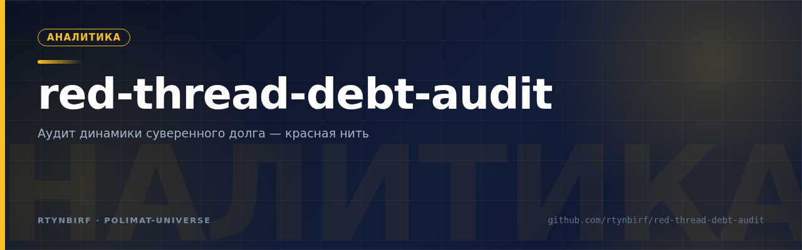
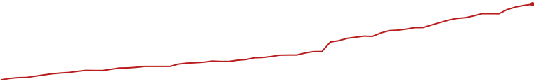

<div align="center">
  
</div>

# КРАСНАЯ НИТЬ — аудит динамики суверенного долга

**Долговая яма = рента.** Шесть граней одной точки границы:
`A_crit = λ=1 = r−g=0 = i = m·(1−ρ)` (+ в v8.0: `i_eff = m·ρ^(−0.45)·(1−ρ)` с полом λ_F и дренажом φ_G).

**Статус:** канон v8.0 закрыт (Раунд 15); кросс-слой R10 исполнен и верифицирован с обеих сторон.
Исследование наблюдательное: ни один вывод здесь не является инвестиционной, юридической или политической рекомендацией.

---

## Что это

Многоагентная исследовательская программа: аудит динамики суверенного долга на реальных рядах
(корпус 10 кейсов × 2001–2023, WB API v2 / datamapper) плюс модельное кольцо
воспроизводства должника (движок КОЛЬЦО-1 v1–v8). Программа строится как цепь проверок
между тремя независимыми агентами:

| Роль | Слой | Артефакты |
|---|---|---|
| Основной агент (этот репо) | реальные данные v0.1–v8.0 + движок КОЛЬЦО-1 | аудит v0.2–v0.6, матрица переходов R10, каноны v5.0–v8.0 |
| Коллега-полимат | бинарная цепь Δ6/Δ11/r_marg (R7–R9) | `external/kollega_R7-R9/` (вход верифицирован по sha256) |
| Чамберлен | контр-тестирование | встречный тест v5.0 — в силе, ждёт исполнения контрагентом |

## Метод

1. **Вердикт-рамка до первого касания кода** — критерии объявляются до прогона; отклонения не ретушируются, из них извлекаются измеренные константы.
2. **Предрегистрация** — предсказания и спуф-окна (ARG 2002–04+2020, ZMB 2020–21, LKA 2022–23, UKR 2015+2022–24) фиксируются ДО вычислений.
3. **Слои доказательности** — FACT / CALCULATED / MODEL / UNKNOWN разведены в каждом отчёте; UNKNOWN ≠ FALSE.
4. **Числа только из сохранённых источников** — каждый ряд несёт источник, дату выгрузки, определение, правило (колонка `provenance` в матрице).
5. **Реестр ошибок анти-дрейфа E1–E14** — правило выводится из каждой пойманной ошибки (E12: промах инструмента ≠ промах данных; E13: при сшивке корпусов сверяется семантика столбцов; E14: интерполяция ≠ экстраполяция).

## Текущие вердикты (R10 кросс-слой + v8.0)

- Цепь коллеги воспроизводится бит в бит: Δ6=1/3, Δ11=6/11, r_marg=2/5 (VA1); полный перебор R8 сходится точными дробями (VA2); strict-режим гасит именно timing-бит 6 → Δ11=5/11 (VA3).
- Штрафы strict согласованы по слоям: −1/6 единиц (Δ11), −37.5% (r_marg), 5.4% процентного потока (Σie в спуф-окнах, PB5) — один механизм, разные доли.
- PB1 ΔD (97.8% попаданий) ПОДТВЕРЖДЕНА; PB2 ShockResponse ПОДТВЕРЖДЕНА; PB3 направленная форма ОТКЛОНЕНА (post-hoc: 9/11 спуф-лет = годы-события полосы v0.6; фикция неплатежа сидит в неявной СТАВКЕ, не в потоке); PB4 ПОДТВЕРЖДЕНА (задержки GRC 22 / ARG 42 / ZMB 28 / LKA 29 мес); PB6 ПОДТВЕРЖДЕНА.
- v8.0 (модельное кольцо): перенос якоря на seed=23 ПОДТВЕРЖДЕН; пол получил замкнутую форму с измеренным дренажом φ_G≈0.71–0.72 (два независимых семени); 6/6 переносимость закона v7 по замороженным критериям; промах дрейфа в переходной зоне опубликован как E14.
- **UNKNOWN** (честно): семантика слотов Δ6; general_minimality (обе стороны держат UNKNOWN); аналитический член дренажа φ_G; связь λ25 с уровнем D/Y; встречный тест Чамберлена v5.0 не исполнен.

## Структура

```
README.md, worklog.md            — карта программы и журнал
download/                        — опубликованные артефакты (вербатим, имена оригинальные)
  ЕДИНЫЙ_АЛГОРИТМ_Красной_Нити_v5_0..v8_0.md       — каноны (SUPERSEDES-цепочка)
  RED_THREAD_РАУНД_10_REPORT.md                    — кросс-слой: VA1–VA5, PB1–PB6
  RED_THREAD_матрица_переходов.csv/.json           — 230 строк × 17 колонок, 10 кейсов
  R10_верификация_R7R8R9.json                      — машинная верификация входа коллеги
  Red_Thread_Audit_v0_2..v0_6 (py/REPORT/results)  — слой реальных данных
  КОЛЬЦО-1*.py/.json/.csv/.png, ring1_v7.py        — движок кольца v1–v8
  СТРУКТУРА_АЛГОРИТМА_долговая_яма_равно_рента.md, ЕДИНОЕ_КОЛЬЦО_*, АЛГОРИТМ_СТРУКТУРЫ_*
scripts/                         — код прогонов + кэши WB (провенанс)
  rta_*_fetch.py / rta_*_run.py / rta_*_plot.py    — fetch→run→plot по версиям
  rta_r10_matrix.py, r10_crosslayer_verify.py      — R10: матрица и верификация
  rta_v0_2_data/ … rta_r10_data/                   — кэши выгрузок WB (источник/дата в каждом)
data/                            — долговая нить как поток данных (Волна ×4 · П47):
                                   debt.csv (дата/значение/URL-источник) + спарклайн SVG;
                                   регенерация scripts/debt_thread.py, CI ежемесячно
external/                        — входы коллег (вербатим + SHA256SUMS)
  kollega_R7-R9/                 — Δ6/Δ11/r_marg и независимый пересчёт R9
  origin/                        — корпус-источник: RENTA, debt_pit_report, спецификация мишарума, PDF Красной Нити, ЗАДАЧА ПОЛИМАТА, сессионный журнал
```

## Воспроизведение

Скрипты написаны в песочнице с корнем `/home/z/my-project`; раскладка репо ей идентична.
Опубликованные скрипты не модифицируются — мост снимает подстановку корня явно:

```bash
python3 scripts/rta_repo_run.py scripts/rta_r10_matrix.py        # матрица 230×17 из кэшей
python3 scripts/rta_repo_run.py scripts/r10_crosslayer_verify.py # VA1–VA5 по external/kollega_R7-R9
python3 scripts/rta_repo_run.py scripts/rta_r10_fetch.py         # живая выгрузка WB API v2 (сеть)
python3 scripts/rta_repo_run.py scripts/rta_r10_plot.py          # панель рисунка R10
python3 scripts/rta_repo_run.py download/КОЛЬЦО-1_v8_переходная_зона.py   # движок v8 (импорт из ring1_v7)
```

Прямой запуск из корня клона с теми же относительными путями также работает, если корень называется `/home/z/my-project`; иначе — только через мост. Кэши в `scripts/rta_*_data/` позволяют офлайн-воспроизведение матрицы; в каждом кэше — источник, серия, дата выгрузки (2026-09-09, dump WB 2026-07-13).

## Границы

- Все числа — из сохранённых артефактов этого репо (`download/`, `scripts/`, `external/`); чего нет — UNKNOWN, не домысел.
- Выборка кризисная по построению (5 дефолтных кейсов + 5 стрессовых/контрольных); полоса шума — формульные перцентили мирного контроля JPN (v0.6, правило E10).
- Опровергнутое не удалялось: PB3 (направленная форма) зафиксирована ОТКЛОНЕННОЙ; промахи P3/P4 v8.0 опубликованы как есть (E14, φ_G).
- Встречный тест Чамберлена v5.0 остаётся открытым приглашением.

## Смежные программы

- [`rent-mechanism-q43`](https://github.com/rtynbirf/rent-mechanism-q43) (private) — рента-программа R11–R49: ядро Q43 v2, законы L1–L6, инвариант I_K″. Мост между программами: долговая яма = рента (изъятие ограничено истинной рентой, X≤R_true — фискальная теорема R20).
## Исторический слой (Полимат, 2026-11-05)

**ДОЛГОВАЯ ЯМА = РЕНТА: хроника механизма 5000 лет** — слой 0 программы: от первых письменных памятников Шумера (законы Ур-Намму, указы мишарума, Кодекс Хаммурапи ст. 48/116–117) через Солона, нексум, юбилей, канонический запрет и Бентама до МФО (0,8 %/день, потолок 1,3х — ЦБ РФ, 01.07.2023) и мирового долга IIF 2024–2026 ($318 → $348 → свыше $365 трлн). Слои FACT/CALCULATED/MODEL/UNKNOWN разведены по канону; вердикт-рамка объявлена до прогонов.

Артефакты:

- `download/ДОЛГОВАЯ_ЯМА_ХРОНИКА_5000_ЛЕТ_v1_0.docx` — полный текст (13 глав, 4 таблицы, 5 рисунков, содержание, источники; постчек: 0 ошибок);
- `download/M1_вавилон_анатоцизм.png` … `download/M5_r_больше_g.png` + `download/results_5000.json` — численный слой, sha256 в каждом файле;
- `scripts/polymath_5000_chronicle_run.py` — пять моделей (анатоцизм Вавилона; три зоны A_crit — реплика debt_pit_report-v2; аннуитет 10 млн/8 %/30 лет; МФО с потолком 1,3х; r>g), воспроизводится из клона;
- `scripts/docx_5000/` — сборка документа (docx-js, R1/IG-1).

Мост к канону v8.0: ρ-оператор ≡ юбилей/мишарум (календарный клапан чистки), законодательный потолок 1,3х ≡ внешний пол стока λ_F с дренажом φ_G; исторический календарь чисток (16 документированных узлов, таблица 4 документа) — кандидат в независимую выборку событий для проверки задержек PB4 (GRC 22 / ARG 42 / ZMB 28 / LKA 29 мес). Реплика корпуса debt_pit_report-v2 в модели M2 подтверждает качественную картину трёх зон и расходится количественно в зоне A < A_crit (DTI за 20 лет: 524 % в пересчёте против 132,9 % в таблице корпуса); корпус-вход не правился (вербатим), расхождение зафиксировано в разделе 9 документа.

<!-- DEBT:BEGIN Волна ×4 · П47: генерится scripts/debt_thread.py render -->

**Долговая нить · 242 наблюдений · 1966-01-01 → 2026-04-01** (Total Public Debt США, млн USD, квартал; источник каждой строки — [FRED GFDEBTN](https://fred.stlouisfed.org/series/GFDEBTN)):

```text
6-04-01  ▁▁▁▁▁▁▁▁▁▁▁▁▁▂▂▂▂▂▂▂▂▂▂▂▂▂▂▂▃▃▃▃▃▃▃▃▃▃▃▄▅▅▅▅▅▅▆▆▆▆▆▆▇▇▇▇▇▇▇▇████
```

Последнее: **39,462,398** млн USD (2026-04-01); прирост за шаг: +396,977 (39,065,421 → 39,462,398, 2026-01-01 → 2026-04-01).



Данные: `data/debt.csv` (242 строк, каждая с URL-источником); генерация: `python3 scripts/debt_thread.py fetch && python3 scripts/debt_thread.py render`.

<!-- DEBT:END -->
